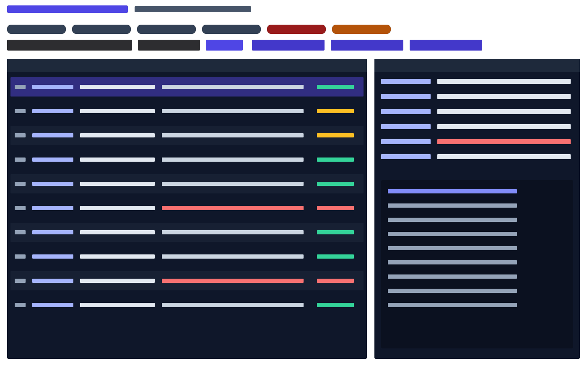

# Kustomize Overlay Viewer for VS Code

Inspect `kustomization.yaml`, `kustomization.yml` and `Kustomization` overlays right in VS Code without running `kubectl` or touching a cluster. Production overlays mix bases, resource manifests, strategic patches, image tag overrides, `configMapGenerator` entries and `secretGenerator` blocks where a deprecated `bases:` list, a `:latest` image tag, a missing namespace or a hardcoded secret literal is easy to overlook. This extension parses Kustomize files locally in plain JavaScript with no cluster access and no cloud calls.

## What it opens

- `kustomization.yaml`, `kustomization.yml` and `Kustomization` files.
- Any open Kustomize file via the Command Palette or Explorer context menu (Open in Kustomize Overlay Viewer).
- Nothing to install, no Kubernetes cluster or `kustomize` CLI required, nothing uploaded.

## The free part

- Resource, base, patch and generator tree: lists every `resources`, `bases`, `components`, `patches`, `configMapGenerator`, `secretGenerator` and `replicas` entry with line numbers.
- Image tag override table: inspects every `images:` entry with `name`, `newName`, `newTag` and `digest`, highlighting unpinned or `:latest` tags.
- Static findings: flags deprecated `bases:` and `patchesStrategicMerge:` fields, `:latest` or untagged image overrides, missing `namespace:`, duplicate resources and hardcoded `secretGenerator` literals.
- Entry explorer: search and filter manifest items by section, text or finding severity, with full line-level details.

## The Pro tools, with 1 free try

Pro adds the audit, diff and export steps: generate a Markdown Kustomize drift and security audit for one overlay or a folder, compare two overlays (such as staging and production) in Markdown to spot image tag or security drift, or export a Markdown manifest map and CSV resource and image inventory locally. Your first try of each Pro tool is free. Zovo Pro is USD 19 once, and the team licence is USD 59.

## Why not plain text

Reading a long `kustomization.yaml` as raw YAML makes it easy to miss that one image override still points to `:latest`, that `secretGenerator` embeds a plaintext password literal, or that a deprecated `bases:` block remains in production. A local viewer puts the resource tree, image overrides and findings on one screen.

## More tools by Zovo

See full docs and install options at [vscode.zovo.one/extensions/zovo-kustomize-viewer/](https://vscode.zovo.one/extensions/zovo-kustomize-viewer/), browse all Zovo VS Code extensions at [vscode.zovo.one](https://vscode.zovo.one/), or explore [Zovo Pro](https://vscode.zovo.one/pro/).
